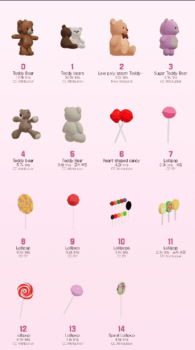

# asset-scout
## 동작 화면



장면 분위기와 필요한 소재를 입력하면 검색어를 확장해 여러 사이트의 API에서 후보 에셋을 내려받고, 렌더 테스트를 통과한 후보만 번호·폴리곤 수·라이선스와 함께 비교 화면에 배치합니다. 사람은 비교 화면에서 번호로 고르고 라이선스를 확인합니다.

- 에셋 1개를 고르는 시간: 30분 → 5분 이내

무료(상업 이용 가능) 배경 이미지와 3D 소품을 키워드로 여러 사이트에서 한 번에 찾아 받고, 영상 안에서 바로 테스트해 보는 도구입니다.
AI 코딩 에이전트(Claude Code 등)와 같이 쓰도록 만들었습니다. 사람은 비교 화면을 보고 번호만 고릅니다.

Search several free-asset sites for background images and 3D props by keyword, download every candidate, and preview them inside a Remotion video before picking.

## 무엇을 하나

1. **키워드 넓히기** — `sky` 를 받으면 `cloud`, `sunset`, `starry sky` 처럼 뜻이 가까운 말로 넓혀 가중치와 함께 검색합니다(에이전트가 정해서 넘김).
2. **여러 사이트 검색** — 상업 이용·수정 가능한 라이선스만 남깁니다.
3. **전부 받기** — 2D 는 썸네일, 3D 는 원본 모델(glb/gltf).
4. **영상 안에서 테스트** — Remotion 컴포지션으로 2D 는 실제 컷에 얹은 비교표, 3D 는 빙글빙글 도는 격자로 보여 줍니다.
   무거운 모델(삼각형 수), 로드 실패는 자동으로 빼고, 누워서 온 모델은 세우고, 바닥판은 숨기고, 검게 나오는 금속 재질은 고칩니다.
5. **고른 것만 쓰기** — 출처·작가·라이선스가 `candidates.json` 에 남아 있어 크레딧을 그대로 옮길 수 있습니다.

| 사이트 | 종류 | 키 | 비고 |
|---|---|---|---|
| [Openverse](https://openverse.org) | 2D | 필요 없음 | 여러 사이트 통합 검색. 위키미디어는 대량 다운로드를 막아서 제외 |
| [Poly Haven](https://polyhaven.com) | 3D | 필요 없음 | CC0 |
| [Poly Pizza](https://poly.pizza) | 3D | `POLYPIZZA_KEY` | 로우폴리, CC0/CC-BY |
| [Sketchfab](https://sketchfab.com) | 3D | `SKETCHFAB_TOKEN` | 검색은 키 없이, 다운로드는 토큰. 비상업·변경금지 라이선스는 제외 |
| Unity Asset Store, CGTrader, TurboSquid, Free3D | — | — | 로그인 필요라 받지 않고 검색 링크만 남김 |

## 설치

```bash
git clone https://github.com/wwk1tten/asset-scout
cd asset-scout
pip install -r requirements.txt   # certifi 하나. 나머지는 파이썬 기본 라이브러리
```

키는 환경변수 또는 `.secrets/` 폴더(깃 제외)의 한 줄짜리 파일로 넣습니다.

```bash
export POLYPIZZA_KEY=...        # 또는 .secrets/polypizza_key
export SKETCHFAB_TOKEN=...      # 또는 .secrets/sketchfab_token  (sketchfab.com → Settings → API)
```

## 쓰는 법

```bash
# 2D 배경 12장 + Poly Haven 모델 2개
python3 find_assets.py public/candidates/sky "sky:1" "cloud:0.8" "sunset:0.7" "starry sky:0.7" --top 12 --models 2

# 3D 소품만 12개(범주가 여러 개면 범주별로 따로 돌린다 — 한 번에 돌리면 한쪽으로 쏠림)
python3 find_assets.py public/candidates/bear "teddy bear:1" "plush bear:0.9" "low poly bear:0.7" --top 0 --models 0 --3d 12
python3 fetch_models.py public/candidates/bear        # 원본 모델 받기(Sketchfab 은 토큰 필요)
```

결과 폴더: `ima_XX.jpg`(2D 썸네일), `mod_XX.*`(3D 썸네일), `m_XX/`(3D 원본), `candidates.json`(출처·작가·라이선스·점수·검색 링크).

### Remotion 에서 미리보기

`remotion/` 의 두 컴포넌트를 자기 Remotion 프로젝트에 복사해 컴포지션으로 등록합니다(`three`, `@react-three/fiber`, `@remotion/three` 필요).

- `BgSheet.tsx` — 후보를 실제 컷에 얹어 찍은 스틸들을 4×3 비교표로
- `PropGrid.tsx` — 3D 후보를 크기 맞춰 4열 격자로 회전. `maxTris`(기본 5만)를 넘거나 로드에 실패한 것은 자동 제외

```tsx
<Composition id="PropGrid" component={PropGrid} durationInFrames={300} fps={30} width={1080} height={1920}
  defaultProps={{items: [{model: 'candidates/bear/m_00/model.glb', title: 'Teddy Bear', license: 'CC Attribution'}], spin: 1, maxTris: 50000}} />
```

## AI 에이전트와 쓰기

`.claude/skills/find-assets/SKILL.md` 를 자기 프로젝트의 `.claude/skills/` 에 넣으면, "하늘 느낌 배경 찾아줘"라고 했을 때 Claude Code 가 연관어 확장 → 검색 → 다운로드 → 테스트 화면까지 진행하고 번호만 물어봅니다.

## 라이선스 주의

- 받은 소재의 라이선스는 각 항목의 `license` 를 따릅니다. CC-BY 는 작가 표기가 필요합니다.
- 키워드가 제목에만 걸린 엉뚱한 결과(예: "red moon cactus")나 워터마크 이미지가 섞일 수 있습니다. 고르기 전에 눈으로 확인하세요.

MIT License
